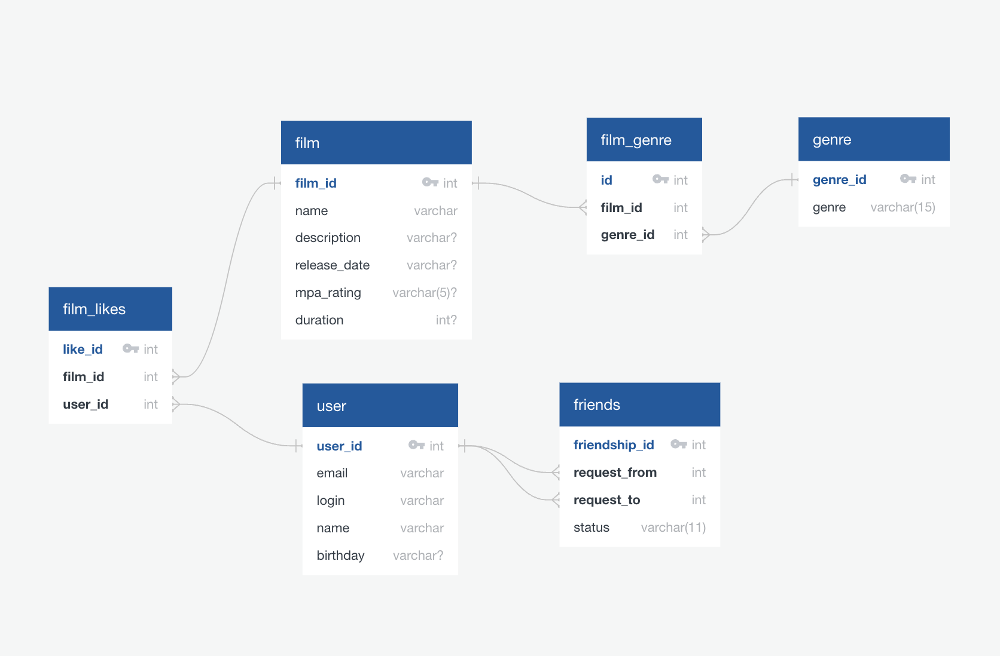

# java-filmorate

Проект приложения **`Filmorate`** — базы данных фильмов. 

Пользователи могут: 
* отмечать свои любимые фильмы;
* находить любимые фильмы других пользователей;
* смотреть рейтинги популярных фильмов.

## Технологии
* Java 11
* Spring Boot
* Сборка: Maven
* База данных: H2
* Работа с базой данных: JDBC

## Задачи по проекту

Проект выполнен в рамках курса по Java-разработке. На нем отрабатывались следующие темы: 

* Spring Boot
* REST-архитектура
* Построение CRUD-операций и логики приложения
* Cистемы сборки и Maven в частности
* Логирование с помощью SLF4J
* Библиотека Lombok
* Централизованная обработка ошибок с помощью аннотаций `@ControllerAdvice` и `@ExceptionHandler`
* Реляционные базы данных и SQL 
* Работа с базами данных с помощью JDBC

Проект создан за 8 недель (теория + практика) и прошел ревью у профессиональных разработчиков. 

## Структура данных

Приложение хранит данные о фильмах (`films`) и пользователях (`users`), а также взаимосвязи между ними: с кем пользователь дружит (`friends`) и какие фильмы ему нравятся (`film_like`). 

Для фильмов предусмотрена возможность присваивать несколько жанров и рейтинг Американской киноассоциации (MPAA). Списки жанров и рейтингов хранятся в отдельных таблицах (`genres`) и (`mpa`).

## Автор

Максим Васильев ([GitHub](https://github.com/max-vassiliev))
